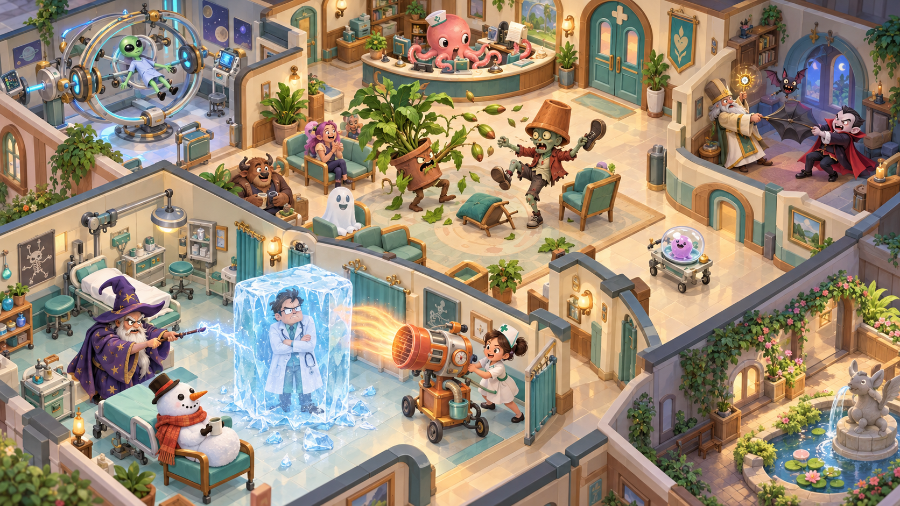

# 美术、动画、声音与内容生产

## 1. 视觉目标和可读性

画面采用明亮的玩具式立体场景、正交等距镜头、圆润角色和夸张设备。概念图用于确定体量与喜剧氛围，实际配色以本节为准；概念图不是实机截图或可直接拆分的游戏资产。

体量与氛围基准为[场景概念图](../assets/hospital-concept.png)。建筑及大面积地面采用暖白与中性浅石材，界面采用深蓝，家具和医疗主体采用浅蓝、灰蓝；手术区与病房以浅蓝、淡紫区分，珊瑚色和淡金只作小面积喜剧与操作强调。界面、地面、家具及医疗主体不使用大面积绿色或青绿色，植物保留自然绿色。患者主色与所用机器至少在明度或轮廓上有一项明显区别。场景细节服务于观察患者，不把所有地板和墙面都做成高频花纹。

默认相机yaw=45°、俯角=35.264°，正交纵向锁定。Q/E每次改变yaw90°，只提供四方向；最小纵向size18米、默认42米，缩远边界取原90米与当前层全层概览所需size的较大值。概览按真实本层投影包络、实际三维视口及原生场景安全矩形计算，规则由camera_view与技术规格§5拥有。每个种族的宽深高由内容目录body定义，模型必须匹配，不能统一缩成1.4米。长颈鹿高4.8米、竹节人高3.8米但仅1格宽；大象和土星旅客占3×3格，石巨人高6.2米。设备主体通常≤4.5米，伸缩支架/高门可至7米，其动画包络必须登记。角色夸张比例优先头部、四肢末端和关键症状，不使用写实恐怖细节。

普通墙高3米，高门所在墙段生成对应高度门柱和过梁，不让5.8米门贴在3米墙里。室内不显示屋顶，角色可高于普通墙；原位换门同步替换局部墙面外观，不改变邻房面积。朝镜头两侧墙默认降至0.7米，远侧墙保留完整高度；选择角色时其前方遮挡物以轮廓方式透明，不让地面网格透过所有建筑。镜头转向结束后重新判定墙面，不把墙的显示隐藏误当成寻路通透。

三个阅读层级：当前层概览认出房间用途和队列；常用视图看清症状、人物关系和机器关键动作；近景看表情和微观演出。远处角色没有眼部动画时仍保留显著症状姿态。微观观察窗的常态窗面使用当前真实居民与动作状态的轻量材质图像；玩家放大观看时才使用同一居民的实时近景展示相机。近景资源全视图复用一份，不为每扇窗或每辆载具建立独立实时相机，不建立另一套游戏世界。

## 2. 模型、骨架与导出契约

80种居民均有独立可辨剪影，使用9种骨架配置：biped、quadruped、longneck、plant、tentacle、float、blob、object、micro。骨架可共用动作，但不能把不同居民简单替换材质。普通人类使用biped骨架和独立头发、服装、年龄外观；员工制服作为角色配件，不复制一份医生物种。九种职员骨架同时提供真实承托中的睡眠、正常醒来与安全中断离床姿态；微观群体仍为一名职员，长身体按展开床面制作，不以缩模藏进普通床。

源文件单位米，Z向上由GLB导出转换到引擎坐标；地面根节点置于脚底中心，模型变换应用后导出。禁止负缩放、不可控骨骼约束或依赖运行时Blender修改器。角色根节点负责位移，行走动画不含root motion；模拟负责真实位置。

所有角色提供以下插槽：head、look_target、hand_l、hand_r、treatment_anchor、emotion_anchor、carry_anchor。非人形以虚拟骨骼提供同名语义插槽，例如火苗的hand_r是右侧火星位置、微生物的treatment_anchor是培养皿底座。机器适配器通过插槽工作，不用种族名写特判。

每台机器提供patient_anchor、operator_anchor、repair_anchor、effect_anchor、camera_focus及四段动画标记。锚点位于建造定义的操作位置范围内，导入器验证偏差≤0.05米；模型看起来能进而实际占地不合法视为资产缺陷。

通行与普通症状动作的局部实体范围须在当前有效身体E（种族身体与symptom_envelope的并集）内，沿路径移动的扫掠仍由原移动规则校验。治疗承托、床台卧姿及上下床、安全离位，依据该阶段已验证的本人姿态、转换扫掠和原设施预约范围制作；卧姿占用投影不回写通行E，医护操作区不能被患者动作借用，全部轨迹不越实际预留。蘑菇帽、树冠与面包身体的膨胀使用病例声明的实际范围，入院镜头即可看见；同一病症在不同身体上的尺寸各自定义。治愈收尾先完成真实结算再恢复正常外形，原已占床台仍待实际离位后释放；失败动作不能把仍需大空间的患者画成已缩小。健康到岗的同种族职员不会带着患者专属膨胀外形。

GLB及素材命名使用稳定内容ID加用途，如core_s49_body.glb、core_m37_machine.glb、core_d37_symptom.anim。源资产留在art-source，成品只放assets，重新导出不得覆盖手工编写的Godot控制逻辑。Godot场景通过包装节点引用导入资产，避免修改导入缓存。

## 3. 资产数量与交付物

| 资产批次 | 正式交付数量 | 完成标准 |
| --- | --- | --- |
| 居民主体 | 80个模型、每个4外观方案 | 正面/背面/四向等距、近远LOD、症状与治疗适配截图 |
| 通用动作 | 9骨架×9动作配置 | idle、walk、sit、notice、talk、cheer、upset、recover、interact；不适用动作有明确等价姿态 |
| 病症表现 | 154组基础病例表现、334条额外种族适配变体 | 488条绑定全部能看见症状与康复，变体表为验收依据 |
| 医疗主体与演出 | 六类主体各有2级升级配件；84套门诊四阶段自动演出 | 工作量映射一致、成功和失败结局、暂停恢复、维修动作 |
| 主要事件 | 25套主体演出、25套指定附属反应 | 双方配合、处理员工动作、超时收尾；冰冻不得有永久僵直 |
| 熟客回访 | 6套有前情的公共区演出 | 同一对方、可中断、逐条低动态姿态；医患回访支持九骨架，道具不实际加热、不越出预留区；配件不可售、不重复发奖 |
| 全体型生活 | AE01…AE03三设备及九骨架承托/操作姿态 | 一至三格、高至6.5米、固定主体的身体受阻/使用姿态齐全；免维护设备不制作虚构故障或维修状态 |
| 日常互动 | 72套配对演出 | 叫号1秒内安全退出、不中断诊疗、不同角色体型对位 |
| 居民故事 | 12套开场/完成演出、12件纪念物 | 每条至少一项专属完成演出，阶段中间使用常规玩法 |
| 社区活动 | 5套通用三段演出、15种性格/关系变体、8位故事身份的外观与职业搭配 | 在各自随机人数范围内完整表演；复用80种族主体，八位身份不重复算新种族；集合、1秒收尾与真实散场齐全 |
| 家具装饰 | 50件基础条目 | 模型、图标、操作位置、材质、功能/纯装饰说明；维护集合内设备有完好/待修/维修姿态，免维护家具只展示真实使用状态 |
| 多层与招聘 | 3种竖向设施、实际端口、楼板施工、7岗位头像卡/8履历/6工作习惯表现 | 1F买地仅草地，产权线不是墙；在建上层只有信息轮廓与实际施工，完工才有空板，房间另建；单站梯不画2F出口，高宽拒绝与巨型真实乘梯可辨，候选能力费用清楚 |
| 建筑模块 | 4套墙地配色、六型门及1/2/3格通路、窗、围栏、路面 | 四向切墙、拐角连续、与网格轮廓一致 |
| UI图标 | 种族80、病症154、医疗主体6、房间17、家具50、门6、任务分类3、通用操作32 | 同一笔触和轮廓，低分辨率也可区分 |
| 手术/住院 | 整合手术台与通用护理床、4职称徽章、6性格动作、24手术四段流程、53身体适配 | 衣服徽章不复制种族模型；显微/长颈/巨人承托与床型匹配，恢复、查房、转床明确可见 |
| 舒缓方案 | 488绑定的慢速与安抚动作层 | 每病例有安抚前奏与清楚的方案差别；不只把普通动画全局减速 |
| 新日常 | 8材料、6服务设备（含员工床、医生桌与护士台）、4娱乐设备、80种族土特产、80回馈表现、12性格行为、17诊室互动、24服务情境 | 多数动作复用九骨架，但每条须验证角色身体与情境；谢礼可辨、装修过程可见 |
| 空间整理 | 9张内置蓝图缩略图、8张改造引导卡、源/目标与体型通路叠加层 | 复用既有房间、机器和临床布局；显示等待腾空、库存故障、材料费用及施工缺口，不增加新房型或免费资产 |
| 渐进引导 | 十项开院卡、九类情境短说明及键盘/缩放布局 | 只定位真实对象；已错过的场景用记录解释，示意插画不能伪装实时世界；冰冻提示共用预算 |
| 候诊生活表现 | 2类服务的6种内嵌动作、10种性格入座与低动态姿态、随身杯与隐私帘、暂离叫号状态 | 入座动作复用自身候诊卡；生活动作不加时不送资源，如厕只呈现帘外，全部身体真实适配 |
| 跨层通行 | 三种连接的排队、真实移动、不可用/低动态标记；电梯另有空载接人姿态 | 复用方向箭头/层数尺与已有卡片，真实空车没有乘客，稀疏高层只显示起终层，不加时或常驻人群 |
| 非医生履历 | 六岗位首件工作表现、实践条与资格独立展示 | 原动作与道具复用，叫号1秒内响应；护理能力不冒充手术能力 |
| 任务与愿望 | 8类指引卡、故事并列条件/任选路径、暂停与待领状态 | 真实缺项可定位，具名角色不以外观替代，不用虚构来信推动领奖 |
| 经营阅读 | 6类账页、资金来源分项、三日结算时间线及便签 | 盈亏与现金变化名称清楚，预测标出假设，直接资助不画成现金礼物 |
| 成长与记忆 | 6种成长短动作、4种维修完整状态表现、6张研究路线插画、9类就诊原因图标、8类院史卡 | 动作复用原角色骨架和工具道具；不把插画当真实来信，院史卡只能取已发生事实，缺照片保留文字版 |
| 工作状态表现 | 6医疗主体状态、10专业道具反应、6设施受阻姿态、5号签状态、4治疗包展开、4椅子效果状态、4清洁来源状态、9骨架睡眠/醒来 | 复用已有业务阶段、原占位与计时；每项有低动态可读版本，不以动画完成触发业务结算 |
| 声音 | 84治疗演出音效组、13家族非语言音效组、25主要事件音效组、界面16种 | 无对白录音/TTS/拟语声；音乐与物件声遵守并发预算，必要状态用独立图示/文字 |
| 音乐 | 4首循环配乐 | 音量可独立调整，循环无明显接缝 |

334条额外适配指488条总适配减154种病症代表适配。每种族都必须实际在兼容机器上验收，骨架复用不免除测试。4首配乐为大厅、庭院、夜间、庆典，各2—3分钟，有15秒交叉淡入淡出，不每次镜头移动换歌。

活动不得按固定八人编排镜头。合影验证4/9/16人和微观、3格、瘦高混合站位，所有实际来宾都有画面位置；镜头只在玩家点“观看活动”后自动适配范围。通用动作以准备、共同动作、收尾三段适配人数，变体按真实性格绑定表演者，其余邻居有简短回应。低动态模式保留同一名单与业务工时，静音下靠动作、画卡和图符仍能看懂情境。纸叶、杯垫和音符旗只作演出道具，不冒充可出售物、真实垃圾或新功能设施。

## 4. 模型与渲染预算

角色近景≤3,000三角面，常用≤1,500，远景≤500；单机器近景≤6,000、常用≤3,000；普通家具≤800。角色常用材质≤2、机器≤3；同家族尽量共享1024纹理图集，特写机器最多2048。角色骨骼≤40，微观个体用实例化或简单动画，不给每个培养皿内小点独立模拟实体。

标准画质单视图目标≤400 draw calls、≤1.5M可见三角形；原透明覆盖20%由transparency_view按实际三维视图片元入口像素并集定义，叠加次数另记而不被并集隐藏。一盏方向光提供主要照明；最多8盏可见局部装饰光，默认不投影。阴影仅关键角色与机器，低画质改用脚底软影贴片。动态建造不能依赖预烘焙整张医院的光照，使用固定环境光、顶点色与材质粗糙度取得玩具质感。

正式资产同时交付部件的真实网格/Surface材质布局、opaque/cutout/alpha_blend分类、骨骼/顶点形变要求、可用刚体参数、LOD/准备姿态资源身份及验证包络。材质颜色参数能否按实例独立使用必须实测，不把同色/同家族自动当成相同网格。静态家具/建筑与兼容机器部件优先按当前视图合批；无骨骼远景姿态只有经过真实阶段、身体与症状一致性验证后可用。近景骨骼默认原当前主表现，专用skin_pose_instancing适配必须通过实际后端和完整等价性验证；透明排序和不兼容资产继续原管线，扩展资产可先沿原管线，全部可见角色保留自身剪影与必要状态。技术规格§5及visual_batching拥有成员、槽位、预算与迟到绑定合同。

独立骨矩阵适配另交付原rest网格、骨顺序/逆绑定、索引/规范权重、Surface shader与参数通道、实际变形包络及原管线对照证据。只支持已验证刚性骨变换/4权重/40骨范围，不强改非均匀缩放、形态或透明病例；未知适配保留原完整身体动作。逐顶点位置≤0.005米、法线/切线≤1°及原0.05米锚点门槛须有实际测量，Compatibility的局部行号和RGBAF页读取/主阴影也实测；未验证不得标为已完成合批资产。满页上传/CPU姿态/双份矩阵及旧页释放都计原资源，不能从128×64小页算术声称密集近景400调用或本机流畅通过。

资产验收记录真实批/回退部件及各Surface提交成本，不能用组数替代绘制调用。多份角色外观尽量共享只读主体与材质，独立染色/参数不能串到另一实例；带实例参数的材料与普通回退材料须表达同一真实主体/状态。未能满足画面预算时先检查相容性、冗余Surface、姿态/透明成本和实际提交，不减少合法就诊人数或病症。大平层640人样例及全层概览必须在正式资产下测原帧/步/内存目标，纸面合批不构成完成证据。

玻璃罩、幽灵身体、光图、粒子与脚底软影交付实际透明管线/采样说明、普通与低成本版本的四向剪影和必要状态对照。大片透明贴图空白不能视作没有片元工作；不透明边框、裁切小图和紧贴实际图形的网格仅在保持原形/当前阶段、无排序缺陷后采用。必要透明主体不强制实心化，装饰简化不免除原症状、伸展、故障或主要笑点验收。全层与密集近景分别记录覆盖并集和叠加负载，准确工具不可用时保留未测，投影面积估计不冒充20%通过；诊断截图/额外通道与正式计时分开。

微观窗面的图像以绑定居民自己的剪影、当前表情和动作阶段制作，指挥旗与光点保留原互动/活动的起因、偏差和收尾。普通窗面不持续渲染另一遍三维医院；放大视图只实例化当前名单需要的身体与原道具，人数随实际名单而非固定八人。近景目标分辨率按面板实际像素和总显存预算确定，缩小面板不保留更大的闲置渲染目标；最低配置与200%界面缩放均验证症状和小旗可辨。

角色连续姿态近处30Hz、远处15Hz按现实时间采样，由pose_sampling和技术规格§5定义错开相位、迟到取当前、暂停/低动态与离散状态刷新；3×不乘骨架频率。视野外不排骨架采样，必要业务姿态仍由原事实保存；角色根位置与镜头插值继续按渲染帧执行。正式九骨架验收包括30/15Hz、低帧错过周期、原身体/症状切换、治疗结束/冻结、暂停恢复与切层当前姿态，不能把采样误差当成穿门或延后必要状态的理由。屏幕最多24个粒子发射器、每个最多32粒子；超过预算按距离和事件重要性降级。种子大战最少保留三枚有清晰轨迹的种子；冰冻至少保留医生眨眼、冰壳与护士热风，让低画质仍能看懂。

资产交付同时记录模型、纹理、动画与配件的共享资源身份和导入后字节数，用真实分配核对预算。常驻可见资产、空闲缓存与加载中的临时副本合并计量；LOD与缓存只能降低显示成本。身体剪影、病症关键结构、已完成升级识别点、真实伸展边界和故障标识保持可读，不能以“不可见”代替一个仍在院内的角色。切层后的绑定、回收与直接映射当前姿态遵循技术规格的表现资源合同。

标准档以技术规格的本机Arc基准验收。75%三维比例保留原生界面和选中轮廓，文字不先画到较小纹理再放大。100%/75%/约67%均检查细长身体、微观载具、症状附件和伸缩边界，LOD首先减装饰细节与次要粒子；主要动作的起因、高潮、收尾及实际暂停/结果状态保留。图形512MiB目标包含渲染目标、纹理、模型、动画资源、空闲缓存与加载副本；集显共享内存必须同时观察进程工作集与系统压力，不将同一分配重复相加，也不遗漏驱动报告的额外分配。

设计基线不依赖SSAO、实时全局光照、体积雾、镜头景深、计算着色器或物理布料。材质与特效必须在选定Compatibility路径验收，不能在别的渲染器截图后当作交付完成。[Godot渲染器能力](https://docs.godotengine.org/en/stable/tutorials/rendering/renderers.html)。

字体交付沿原Noto Sans CJK SC Regular/Medium与许可证要求，补记实际字体/回退资源身份、导入参数及原生UI下五档缩放的字形清晰度。原14/16/18/24逻辑像素须覆盖最长合法名称、罕见汉字、组合字符、数字金额与中文输入中的预编辑文本；字体缺字和排版越界分别记录，不用替换名字掩盖问题。字形纹理页、暂存和旧字号实际驻留按技术规格的唯一资源口径验收，不按字体文件压缩大小估计显存，也不预设引擎能够独立回收任意字形页。

## 5. 动画节奏和幽默

治疗四段为准备、荒诞过程、高潮、安全收尾。主要笑点每次治疗只发生一次，过程段允许轻循环，不能在3×速度下重复三次高潮。病人只在自己的逻辑阶段行动；例如法师的失败投诉必须发生在机器松开患者以后。

### 能看懂的治疗节拍

门诊四段使用balance.treatment_presentation.beat_basis_points的15%/45%/25%/15%，对应演出的四个beats。令N为本次已冻结的总工作tick，累计边界Ci=ceil(N×前i段基点之和/10000)，最后边界必须等于N；当前完成量d在Ci之前属于该段，达到边界进入下一段。各段长度取相邻累计边界之差，不能分别向上取整后相加。这里的“准备”是已开工后的摆姿势节拍，未开工的ClinicalPreparation和领包仍按各自规则执行。84套门诊演出的最后一段收回各自器械、解除操作锁定，承托面在患者真实离位前保留；不要求吃饼、给邻座遮雨、挥手接物或提前走路。康复短动作引用本病例recovery_variant，在真实治愈后沿原离位动作播放，不增加服务时间；动作所需物件必须来自既有随身造型或设备道具，缺少时使用原骨架的简短放松姿态。

片段按实际完成比例切换，不按现实播放完毕才放人；短疗程压缩动作幅度，长疗程只循环过程段。手术只将术中工作映射到四段，不挤占原术前准备、15秒苏醒、真实转床或住院恢复。检查依据证据采集工作播放，病床依据实际恢复量和当前护理/查房状态播放，不假装床上一直在执行一次门诊治疗。

TR01基础36秒、能力/升级/劳累等其余修正均为1时，常规N=360tick，累计边界5.4/21.6/30.6/36秒，各段5.4/16.2/9/5.4秒。舒缓N=648tick、64.8秒，累计边界9.8/38.9/55.1/64.8秒，各段9.8/29.1/16.2/9.7秒；合计仍64.8秒，最后安全收尾没有额外取整补时。它们只说明冻结工作量的演出映射，实际病例须先应用原人员/设备/专业与方案工时规则，不用样例替换真实总量。

六种医疗主体的medical_progress_cues同时定义工作、暂停、工作完成和低动态小戏。它们是病例主演出旁的机械道具反应：整复台的定位夹先对齐自己，调理舱的节拍球排成标点，奇想台的书签确认当前检查页，诊断台的症状卡排队归档，手术台的空夹检查自己，护理床的枕角等候整理。道具只在原预约范围内活动，不生成居民、库存、垃圾或额外服务。病例的主体动作优先；同屏同设备只保留一个次要动作，高潮期间次要道具定格，不与患者争抢视线。

单视图同时最多让3台可见医疗主体播放次要道具动态，优先正在观看的对象、当前选中对象，再按镜头距离、设备ID排序；同一对象只算一次。这里只裁减备用梳子、节拍球、书签等次要动作，全部患者、实际临床步骤、进度、暂停原因与故障标记仍正常显示。没有获得动态名额的设备保留当前状态姿态，不停止工作，也不把名额变成可同时接诊设备数。主体进入高潮时暂时定格自己的次要道具，不抢夺另一台的临床表现。

缩放、切层或画面繁忙后重新进入视野时，次要道具直接定位当前服务阶段，不排队播放遗漏片段、不开新随机抽签，也不保存一份待演清单。低动态模式统一显示稳定姿态。次要道具不额外建立独立音效循环，病例本身的机械声和现场反应仍按原音频预算播放；画面留白不改变经营噪声、费用、库存或任何恢复速率。

三类门诊主体各自按当前TreatmentRoutine.specialty_id选择working_variants，共10种专业工作小动作，匹配后替代通用working_scene，不叠加播放、不抽取新随机数。道具再取本病例实际拥有的内容：收纳袜子只用于原收纳病例，页码只用于书页，梦羊只用于捕梦；没有对应结构便只显示检查框和工具定位。未来扩展未配置专业小动作时使用通用功能姿态，不能随机套用另一病症。暂停、收尾和低动态仍使用原状态，低动态取本次专业动作的静止构图。

暂停状态取真实服务原因，不用统一睡着表现掩盖缺人、故障或安全等待。工作完成的小戏只表示相应服务工作结束，不代替确诊、治愈、苏醒或查房结论；护理床的完成姿态表示本次护理/查房动作收尾，不使患者自动起床。过程可以小幅循环，收尾每服务工作完成最多一次，不延长占位，读档定位当前状态。

六种医疗主体各有一条进度提示：诊断台整理线索，整复台理顺结构，调理舱调整节奏，奇想台整理奇妙事物，手术台团队配合，护理床安静恢复。它们读取原服务、Attempt或WardStay，不创建第二个倒计时。暂停、无覆盖或故障等待时，工作动作与进度一起停在合法姿态；患者可以呼吸、眨眼，不能继续演出已经推进疗效的高潮。

实际操作者对应能力1…2级时动作认真核对，3…5级时衔接更流畅；所有合格人员均能安全完整操作，不把初学者演成笨手笨脚。高等级设备的固定升级结构来自设备自身，操作节奏取本段冻结的实际人员能力，不能借全院最高能力点亮别人的效果。手术各人显示自己的动作，既有团队发挥率仍按原公式。能力升级发生在服务中途时，下一项新服务或新的安全护理覆盖段再切换操作表现，跟随原工作倍率的冻结边界。

53条手术身体适配明确操作目标，长颈的结、线团的线头、蘑菇的菌盖和树人的枝冠各用自己的插槽；投影与原身体相对应，不混入另一种居民的部位。24套手术第四段只完成器械归位、支撑保留和检查待命；患者此时不站起、敬礼、接物或表演已康复动作。页码号牌、剪影机械臂和梦羊均为原设备内的演出道具，不生成助手职员、独立患者或可收集物。

高潮表达机器荒诞的过程，不提前宣告治愈。最后一段将器械安全退回并解除操作锁定，承托仍保留，患者与伸展附件真正离位后才释放原占位；只有真实结算成功才移除对应症状并呈现康复动作。需住院的病例保持“治疗完成，恢复中”，失败也安全收尾，之后说明下一次尝试或转诊。读档定位当前进度，不补播已越过的高潮；静音与低动态版本用四个稳定姿态表达同样信息。表现道具不生成实物垃圾，实际耗材和清洁仍由原业务完成事实产生。

失误表现使用圆眼眨动、头顶小星星、衣服被熏黑、软体变形。打架无血液、写实伤口或痛苦尖叫。普通人类14条病例从身体不适、外部幻想投影与治疗工具形成可读因果：喷嚏气流吹风车，牙齿投影上的小火车收糖霜，喉部声音投影被软刷梳开，睡眠症状里的羊给闹钟盖被。身体始终在合法承托位置，工具不钻进真实喉咙或展示伤口，康复不靠凭空出现的食品或额外服务。普通人类的疾病表现温和，牙痛用捂腮和符号表达，牙科机器保持玩具风格。角色尊严保留，幽默针对荒诞设备和关系，不把真实残障、体型或族群当成笑料。

每套事件至少有清晰前兆、一次高潮和一段释放紧张的收尾。冰冻医生的眼睛能动；没有暖风车时冰壳自行出现裂纹并融化；护士到达后解冻速度立刻可见。最后一片雪花投影在原医生包络内轻轻模仿刚才姿态，不再找新演员或搬动椅子；医生仍以实际解冻、休整和返岗为准。附属笑点使用原事件的参与者与时限，原条件已消失便省略，不把救场人员演成主动捣乱者。E02的蝙蝠是斗篷轮廓而非缩小身体，E11/E23用原地页签与图卡交互，E18只发生肩线图示误读；E12的沙纹始终留在透明道具盒。道具与动作扫掠范围必须落在原预留范围内；缺少空间便不进入候选，不靠穿模或缩模完成。

导入演出时分别登记所引用内容ID、骨架语义插槽、合法阶段、最大姿态包络和低动态姿态。临床四段来源只有TreatmentRoutine或手术TreatmentPlan；TreatmentBinding只覆盖前三段的身体/道具适配，最终康复独占recovery_variant，SurgicalAdapter补充实际承托与操作部位。机器次要道具、治疗包和成长贴纸不能自己创建额外临床阶段。低动态保留当前原因、器械位置和结果状态，不强制再制作一套独立数值流程。

状态恢复可以从任何动画阶段定位：存到47%后加载应显示47%对应的机器与角色姿态。音效不因恢复把之前的全部节拍补播；已经发生的一次性高潮使用事件标记防重复。

### 同一病例，两种操作节奏

常规与舒缓共用病例的真实身体、靶点和四段；gentle主动作层更清楚地核对工具、以较小摆幅处理同一目标，高潮仍一次，最后同序安全收回。九骨架按各自插槽制作，不全局降低常规动画播放速度来冒充另一方案。普通人类、僵尸、树冠和微观载具都保留本病例操作结构；舒缓不表示患者已经不害怕，也不替代真实沟通。

三台门诊主体的12段gentle次要小戏及各自低动态姿态复用定位尺、备用梳子、节拍球、书签和页签。缓冲小标、软垫可作为原工具槽内的非功能静态配件制作，计入该主体的共享资源预算，不生成库存、铺地、治疗包或新的PlacedObject。它们只整理自己的道具，不改变病例靶点。只有实际工作阶段、正确模式及已有动态名额才运动；主高潮全部定格，原专业小戏不与舒缓小戏叠放。暂停/结果沿原姿态，缺少次要资产可省略，真实模式文字和主演出保留。

制作验收同病例展示standard/gentle四段、当前工作暂停、C档转床、首试失败和低动态；逐段核对真实工作边界、空间和原结果揭晓。动态名额不足、切层与读档直接取当前姿态，不补播、排待演清单或建立独立音效循环。新增主动作层和静态配件计入本机图形资源与正式160/640人负载，不以文案或算术声称可读性与流畅度已经通过。

## 6. 声音与安静的信息提示

医院没有广播系统、广播台词、广播设备、播报队列或广播设置。对话只使用文字，不制作或播放角色对白录音、TTS、拟语声或替代对白的含糊人声。声音来自音乐、当前机器、角色材质与动作的非语言音效和界面操作。叫号沿既定无语言规则，只用号签、头像与站点指示自动衔接，不播报、不生成叫号台词、不要求确认。经营问题仍使用可定位的合并提示，任何必要信息都能在静音下读取。

音乐、机器、角色音效、UI四类音量独立。audio_presentation的并发预算仍为设施现场声6路、角色非语言反应声6路、UI2路、音乐2路；字段中的voices指混音声源，不是对白语音。音乐交叉淡入淡出的两条轨道也计入预算。设施声包含医疗、施工与日用物件的实际使用声音，不能给每个内部零件另开循环。材质摩擦、纸片翻动、轻铃、汽笛短音与无唱词旋律可以表达现场，没有喊话、播报、对白或由拟语声代替台词。预算只限制声音表现，不限制正在工作的机器、居民或治疗；重复声源按距离与重要程度压低，不以突然超大音量惊吓。

现场候选只取当前楼层镜头可听范围，利用原空间索引，不每帧扫描其他楼层全部演员。优先正在观察的真实对象，其次当前有意义的临床/事件非语言音效，再按距离与稳定对象ID排序；同一设施的多个音层按当前阶段离线预混成一个实际片段，共享一个真实播放名额，不能借复合子流隐藏并行解码。满额时先减弱或省略远处同类次要声，不反复抢占让机器声抽动；一次只选当前实际需要的声源，不为落选者排队。必要UI状态始终可见，声音没有独立的“必须播完才可操作”锁。

正式片段记录阶段绑定、循环/短音类型、导入后实际格式/采样率/声道、文件及运行时缓冲字节和可读音量；原1dB真峰余量继续保留。播放器来自原有界池而非每演员/物件各一套，场景槽max_polyphony=1，淡出和所有真实子流仍计原6/6/2/2名额。技术规格§5与audio_resources拥有绑定、显式stop回收、静音停止现场解码、恢复只当前循环及工作集计量；声道数不代表对白录音，片段中没有广播、TTS、拟语或叫号语言。微观近景、同机器升级配件与不同身体不重复开相同循环。实际解码/声音选择不得改变原临床结果、环境噪声或图示信息。

切层、切医院和资源绑定失效时解除旧场景声源；返回只根据当前阶段接上仍在运行的循环，不补播遗漏的启动、高潮、治愈或非语言反应声。暂停时现场工作声平滑静下，UI与音乐按设置继续，环境噪声事实仍按已冻结世界保持。恢复时接续当前状态，不重新触发一次治疗完成；3×速度不将短音效机械变成三倍音高，也不为等它播完拖慢服务。低动态与音频裁减均不消耗业务随机流。

dialogue_presentation只投影当前聚焦病例已经真实开始的医患沟通，现有六种doctor_responses.short_line提供医生默认文字，不从场景描述拆出对白、不替未到岗医护说话，也不提早透露疗效。全屏最多一张医患文字卡，放在原病例详情而非角色头顶，正文最多两行；发言方姓名使用该次真实回应的绑定。日常互动、熟客回访、社区活动和叫号不进入此卡，不另铺现场反应字幕。

这张卡通常保留至少4现实秒，只有主动切焦点、关闭或更高优先提示需要位置时提前收起；不因此延长初诊、准备、失败反馈、护理或真实安抚。已经显示的短句可在同一聚焦病例内读完，服务状态仍取此刻真实事实；到期后只取当前沟通，不建立旧句队列。未查看阶段不补字幕，切医院清掉旧绑定。医患文字显示与音频声道相互独立，声音回调与阅读计时均不生产医疗结算。

病症图符是原身体/道具演出的组成部分，不是额外对白层。“重启招呼症”与“关节客服灯牌”没有语音句子；字幕抢答与午睡字幕用小条内的招手、休止符、枕头和圆点表现，不滚动整句、不逐字创建3D文字节点。回声迟到、串台、句尾拖尾和灯芯绕口令分别用迟到图符、无词短音、收不回的标记和绕成乱麻的光图；汽笛只作非语言短鸣，书页依次展示插画，错用标签和套叠道具气泡只显示图符。客服、道谢、报站和冷笑点的非功能小牌使用图符；真正的票号、房间与数量标识继续显示。每份动作与低动态姿态共用原插槽和包络，不能因画卡替代台词改变身体、互动概率或工时。对话泡泡居民的本体仍存在，只用自己的表情图符，不生成第二套浮动对白。

听到的效果与经营噪声分工明确：音频层只表现真实场景，环境噪声由实际治疗/施工状态和传播规则计算。音量归零、声道裁减、切层或读档时不改变quiet偏好、怒气与体验；反过来，温和的手势、护理图示和玩具音效也不自动变成新的噪声处罚。环境叠层始终能定位实际经营噪声源，不能只靠听声音找问题。

声音源文件采用44.1/48kHz，校准一致听感并保留至少1dB真峰余量。低动态、静音、200%界面缩放与多台机器同时工作须实机验证；静态数据核验只确认不存在广播定义及调用合同。

六种初诊工作小动作共用FUR02的原症状卡、夹子、图页与操作插槽，专业性格只改变次要反应。谨慎的夹子抱住纸角、好奇的观察框观察自己、团队型的折角搭成小桥，均在原桌面道具包络内；不实际搭桥通行、不生观察者、不制造额外纸张库存。动作按真实医生身体的操作端适配，不要求所有种族有手。每种定义具备低动态姿态；原采集动作、病症身体与必要状态保持完整，专用与通用次要反应同占原名额；名额不足或次要资源未就绪只保留主操作，不延迟诊疗或扩大声源预算。

大面积远景资源共用基础材质与几何，保留原物件ID、实际体型、症状包络及必要状态，不把大型居民统一缩成一格。远景、完整资源与加载代理分别验收：远景是正式表现，代理只供真实资源尚未就绪时读取当前尺寸与状态。大型物件跨块不得重复摆放，选择反馈不能随细节层改变；旋转镜头和低动态下的清晰轮廓也纳入正式资产验收。冷加载、局部墙地改建和旧视图退场的真实分配/释放峰值计入同一图形预算，不把整层缓存留在账外。

## 7. 制作与集成流程

每项内容依次经过定义记录 → 轮廓与症状草图 → 低模与插槽 → 动作与音效 → 导出 → 内容验证 → 展示场景 → 游戏病例验收。每个条目具有owner、status、asset_paths、binding_ids、license_source、review_evidence，不以“有模型”代替完整就诊交付。

先制作人类感冒、僵尸零件、长颈鹿打结、微观群落和冰冻事件五项诊疗/事件样板，另加竹节人门框自动长高与石巨人设备使用空间受阻两项空间样板，再加影子缝纽扣手术与巨型病房转床两项临床样板，以及同病不同问诊/敲门安抚、土特产与环境回馈、装修与员工游乐三项生活样板，共十二项，覆盖瘦高/巨大包络、门原位改建、载具、机器、魔法与恢复。它们用于验证整套产线质量和成本；后续154病例、332方案、53手术适配与80种族按同一合同完整生产。若样板制作速度低于预估，调整排期与资产复用方式，不能无说明删掉内容范围。

源资产与导出成品一同版本管理，大型二进制使用Git LFS，病症定义、ID和文案保持可审查文本。AI图像仅作概念或辅助纹理时记录生成来源；概念图不能被当作自动拥有拓扑、骨骼、插槽和动画的成品。

字体采用官方Noto Sans CJK SC，并随包保留许可证及版本记录。[Noto CJK官方资源](https://github.com/notofonts/noto-cjk)。所有外部模型、声音和字体逐项保存来源与分发许可；不下载与基础风格不一致的占位资源冒充正式交付。

医院钟面及工时表现采用模拟规格的统一24小时时钟，文字用现有原生UI字体与数字样式，不新增第二套时钟资源。医院日、小时/分钟与现实保存/性能时间使用明确标签；治疗、施工、睡眠及跨层表现继续绑定原实际工作/移动余量。睡眠450模拟秒对应6医院小时，短入睡动作仍包含其中；电梯每层1秒与上下客各1.5秒、楼梯每层2.5秒的实际进度须可辨，不用模型到站替代业务到站，不因高速档追加缓冲或延长工作。静音、低动态与切层保留同一当前状态，正式工时与30分钟日节奏仍须实机验证。

## 8. 画面质量门槛

每条治疗适配提交：症状静帧、过程高潮、康复静帧、失败及恢复短视频，四个镜头方向中至少两个、正常和减弱动态两种模式。大体型不穿门或穿机器，微观居民在默认缩放能看见载具和情绪，普通人类与奇幻邻居具有同等制作精度。生活设施使用同一原则：微观居民经载具接口取水，非人形使用合适承接器，隐私帘只展示外部标记；六种性格动作及两种随身用品提供普通/低动态对应姿态，不把服务结束画成身体已经离位。

第一次集中检查同时查看本机主要与最低兼容目标设置、三种UI视口，修正同一批缺陷后复核。发现患者症状不可辨、高潮被遮挡、存档恢复动作错位或低画质丢失信息时属于交付阻断；仅有装饰细节偏好可排入后续美术调校。

## 9. 增量内容质量门槛

80种族×4外观是320套外观组合，不是320个独立骨架。每种族至少6病例的入院姿态、异常部位与康复动作逐条出图，488绑定不能仅换名字验收。普通互动97项与回访6项分别提供参与者对位、叫号打断和缺员收尾证据；情境前兆cue资产随对应主要事件验收，检查道具槽与模拟标记。新设备共享动作也要保留不同症状解决的可见因果。门和护理病床提供真实伸展占地与空间不足/足够两种现场；其他设备提供固定主体、完整身体和操作区证据，包含实际占用后的通路画面。

## 10. 医生性格与住院演出

医生四种职称通过名牌边框和可读头衔体现，不以体型、肤色或昂贵服装暗示能力。六种性格各有一组不超过2秒的会诊动作：核对清单、利落翻页、记笔记、安抚手势、整理号单、递照护卡；动作包含在8秒会诊内，不额外延长规则工时。

手术使用软磁夹、发光投影、纸样、棉花云与夸张机械臂。D35把影子缝回脚边，D94展开卡住的四维折页，D62让逃跑螺丝回到门牌下；不制作血液、切口或现实器官操作特写。53适配的patient_support、symptom_target、exit插槽全部验证，纸鹤/线团/微观载具不能套人类躺姿。

病房提供入床、轻声护理、放松休息、完成查房、起床离院、保留姿态转床动作。巨型床与长颈支架拥有明确剪影，床位占用、等待与设备故障可在静音下区分。手术机器故障演出等当前手术结束才开始，不能先显示设备瘫痪却继续播正常流程。护士与医生换班有递卡动作，不改变预约或结算时点。

新增十二项样板中的生活场景要展示因果：病人等久→怒气前兆→敲门→护士解释；说不清症状→不同医生回应→工时与情绪变化；诊疗满意→署名谢礼→可摆放纪念物；医生劳累→带薪休假/员工游乐→恢复。静音也须读懂，不用面板跳数字代替演出。休假医生安全离院，归来沿入口进入；不在患者面前瞬间消失。

## 新增病例的独立表现审计

D115…D154每病四种身体，160条适配逐项核对承托与恢复；TR65…TR84为20套自动演出，复用三种门诊主体。可变梳子、镜片、磁钓竿、风云装置等由主体内机构展开，病人承托可延伸至已登记患者区，不能沿用旧独立机器的大占地或穿越员工空间。每套演出仍需四段可辨因果，复用不降低病例表现要求。

多层样板必须同时表现地面院门、2F诊室、正常/故障电梯和正在别层工作的员工；这些是同一模拟世界的不同视图，禁止用剪辑伪装跨层状态。

## 11. 六类设备的升级与全种族职员

升级让六类主体逐渐更酷炫：基础型轮廓朴实、精修型增加透明结构和同步灯光、奇想型增加悬浮组件与有性格的小助手。动作随病例变化，但同一台机器的等级配件与运行状态保持一致；不制作84套独立购买模型。低画质/关闭闪光保留等级剪影，暂停和故障状态优先，音效不过度叠加。

upgrade_presentations分别给出六台机器的两级动作与静态识别点。灯光全关、低动态或远景时仍能凭板层、轨道、护罩、窗框、工具架、床栏识别等级，不仅换颜色或加粒子。升级过程中保留已完成等级的轮廓，未装好的配件表现为施工，不能提前显示整套新等级；真实完成才一次切换。选中卡始终读取设备实际等级，与外观共用来源。六种升级机构同时交付实际工作和安全待机姿态；当前病例决定工具、已完成等级决定机构轮廓、原服务进度决定动作，不用持续抖动或全套助手轮番登场表示高级。护理床的稳定承托不受次要道具预算影响。

升级不改变基座、身体适配规则或已预约的伸展包络。实物护罩、工具臂和小助手的全部运动范围必须落在这份已检查的空间内；不能用“特效无碰撞”解释穿过走廊上的居民。纯光线、星点和显示屏影像不占格，但不遮住患者状态、操作人员和红色阻挡格，不能承托、搬运或操作真实物件。术台助手只配合实际三人团队的动作，床边云托不能在无护士覆盖时自行推进恢复。

表现按实际设备状态切换：施工显示未完成结构；故障停止工作循环并保留可见故障标识；暂停冻结当前工作姿态；空闲仅保留结构与轻微待机；工作才播放病例动作。故障标识和等级轮廓可同时识别。低动态用固定姿态替代悬浮、旋转和起伏，模拟工作量、当前阶段及进度不变；恢复动态从当前进度接续，不补播错过的高潮。两种模式共用原资产与工作事实，没有第二套医疗结果或动画计时器。

九种staff_rig_adapters提供操作、记录、携物、修理、清扫、施工、教学与休息动作，覆盖80种族×六岗位；每种族保留原身体大小。微观职员用培养皿小车上的控制柄，四足使用脚踏/口衔柄，物件使用侧挂工具臂，巨人用外接升降控制臂；这些是同一设备的操作适配，不是远程服务或额外购买升级。制服与岗位徽章复用主体插槽，长颈鹿不缩身，幽灵不穿墙，章鱼一次仍只做一份工作。全560种组合需验证实际门路、操作区、制服和必要动作；九骨架复用不能替代覆盖验收。80条天赋各有一段轻巧动作，可被叫号/安全工作立即截断，表现不再产生第二次数值效果。

## 设施伸缩与补货的小演出

六组伸缩表现复用九骨架与既有语义插槽。模型的展开终态必须吻合AdaptationReservation真实体积，变形阶段按完整目标占地阻挡；空间不足时保留原形，用短小试探动作与空间提示表达，不播放已经成功展开的假象。床尾、门框、承托臂不能只做粒子特效，低画质也保留边界与阻挡轮廓。

一种治疗包共用纸箱与包体，拆包后按病例变换道具，不增加购物图标。缺货四种反应映射等待、提醒、罢工和复工；用纸牌、空包装与表情体现，不借广播解释。纸牌不封通路，临床安全工作中只显示状态，不强制播离岗动作。真实垃圾持续显示直到清洁员完成，桶内纸片也按同一规则保留。

十八场日常回应的36种结尾各交付普通动作与静态可读姿态。复用原小道具、杂志、书签、牌、镜框与无碰撞画框；不生成五副镜框的五个Actor，也不把八本杂志变成八笔阅读服务。骨架和病例姿态沿当前绑定，只在已有合法道具槽与包络内调整；收框只改演出构图，不缩小人类身体。6/8秒来源仍是原互动，慢性子和朋友结尾不追加等待，叫号按原1秒边界收尾。静态与动态选择同一response_variant_id；只加载当前可见场景所需共享资源，不因36条内容预建全院变体节点或独立模型副本。缺失正式姿态不能由人形占位模型冒充，实机验收覆盖双方角色、普通访客、受限身体、打断和低动态。

轮流点亮的星角、台灯圆光和倒影回应复用原登记光槽/图符及镜面装饰；原光源的缓慢表现计入既有预算，不增加每个星角的实时光源。第三倒影是原图符或姿态投影，不采集全场实时反射、复制医院场景或建立第三个演员。四个回应各有低动态版本；无需闪烁、语言字幕或新增摄像机才能读懂笑点。正式资产仍须按各自骨架、症状包络与可见资源总量验收。

## 职员睡眠表现

员工小憩床使用真实卧姿适配与上下床动作，覆盖六岗位和九类职员骨架。身长决定展开长度；影子、叶冠、载具与附属承托不穿墙。入睡/醒来均由真实睡眠阶段驱动，低动态保留姿态与小牌，不增加摆动、闪光或需要玩家点击的睡眠小游戏。

医生办公室与护士工作台提供到位、整理、待岗、应召和安全离位的正式动作；病例夹与护理卡只投影已有业务事实。staff_base_cues交付病历夹排队、床位签折叠及各自空待办/低动态版本；九骨架共用原桌面范围和实际准备进度，不另建办公室小游戏。九骨架使用真实桌边操作位，低动态保留工作前后状态，不能靠动画远程完成护理或伪造就诊。

四种新椅子各有实际收起/展开/使用表现；轻摇、透明罩、翻页、脚托只在已预留空间内活动。减弱动画保留静态使用姿态及效果小标，安抚完成以Visit真实凭据驱动，不用动画回放重复减怒。

十种性格入座表现复用角色已有候诊卡、身体承托和坐姿层；不交付十个新道具、十套种族专属椅子或常驻旁观者。自身卡片沿身体适配，微观居民只在载具正式提示面呈现，长颈视线与主体不越过实际空间。观察朋友、装饰或日常小戏只在真实对象和当前条件存在时定向，目标离开后直接回普通坐姿。原入座过程结束就停在等候姿态，不能反复整理卡片来延长动画或循环催促。叫号优先，低动态显示同一静态事实；没有卡片适配时保留必要叫号UI与普通姿态。制作验收覆盖十性格、九骨架、看向对象缺失、空间不足与途中叫号，单人坐姿不能假造一场双人互动。

小额补足的回执仍使用原库存页纸箱与包摞：买一包也给真实数量标签留一个很端正的位置。它替代同笔普通到货动作，只在付款/基金代付与实际入库已提交后显示，不叠加两次开箱或发全院庆祝；关闭页、低动态与读档直接保留静态回执。病例指向只出现在当前就绪建议，复工回执只说明该事件条件，不生成医护小队、舞台演员或仓库物流。包摞数量是本次订单数量，患者开包仍等原Attempt真实领用，不能用收货动画替代库存事务。

## 12. 结果揭晓也有小戏

六类医疗主体交付18种result_scenes及其低动态姿态。诊断台的线索夹确认是否够用；整复台的定位尺和备用梳子认真对照下一页；调理舱用省略号、句号和待观察书签区分进展；奇想台的归档夹只盖真实结局的章；手术台把“操作完成”交给后续照护；护理床的记录夹等待真正查房后才展示去向。短动作使用原设备道具与当前合法临床姿态，不要求给全部80种族做同一张失望脸。

没奏效时，量尺把自己的小问号摆正、节拍球把逗号翻成“再核对”、书签暂时把庆祝印章夹住；医生认真说明后续，患者的不适不承担笑点。低动态把相同意思留在卡片和固定道具上。结果姿态替代同次finished_scene，包含在原反馈或安全离位中，没有额外2秒庆祝、持械等待或消费过程。已经离位、镜头外或道具不支持时省略短动作，实际结果文字保持可读。

awaiting_recovery始终使用中性待观察姿态。手术台、床边与字幕不能用颜色、音效、印章或庆祝配件提前区分承诺的成功/失败。cured才接本病例recovery_variant；retry_ready和final_failure保留相应symptom_variant。医生、护士、机器与病例的主要动作仍各取原角色插槽及占用，不凭空增加手、脚、嘴、另一位家属或独立助手。实际站位不足时只留下必要状态，不扩大临床包络。

结果声和字幕复用原现场预算，不单开失败警报、广播或循环催促。工作暂停时不持续点头催治；切层、静音、低动态与3倍速均不改揭晓时点。制作验收同时展示同病例的治愈、首次失败、第二次失败和待恢复片段，以及无手身体、长颈与微观载具版本，核对每一种都能读懂真实下一步且没有提前康复。
